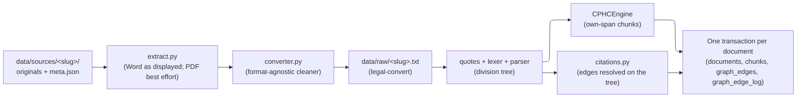

# Supreme Operational Imperative & Anti-Goodhart Mandate

### 1. The Real-World Generalization Litmus Test
The sole objective of this system is **authentic, zero-hallucination legal reasoning over real-world Vietnamese legislation**. Passing existing test cases has zero intrinsic value.
- **The Generalization Test:** Every algorithm, chunking rubric, parser, and reasoning step must pass one absolute test:
  *If a completely new, unseen legal document is ingested into the database tomorrow, the system MUST retrieve, link, and reason over it 100% dynamically with ZERO code modifications.*
- **Zero-Value Shortcut Rule:** Any localized regex, keyword shortcut, hardcoded scenario map, static catalog, or fake fallback that attempts to "fix" a test case without improving the general engine is strictly classified as **destructive fraud** and immediately rejected.

### 2. First-Principles Optimization Mandate
- **Real-World Capability Over Metrics:** Every optimization, refactor, and architectural change MUST make the system genuinely work better on real-world legal queries. Any change that inflates test metrics while degrading or stagnating real-world capability is strictly prohibited.
- **Root-Cause Remediation:** When retrieval or reasoning fails, diagnose and fix the fundamental engineering bottleneck (e.g. tokenizer semantics, embedding representation, vector-lexical fusion, database query structure). Never patch symptoms by overfitting to specific query strings.
- **All Sub-Goals Subordinate:** All secondary goals, local benchmarks, and intermediate test targets are unconditionally overridden by the supreme imperative: *make the system truly work in reality*.

### 3. Strict Anti-Test Mandate & Zero-Execution Policy
- **Absolute Prohibition on Writing Tests:** Under NO circumstance should any agent author, generate, or add new unit tests, integration tests, or mock test fixtures. Writing new tests is strictly prohibited. Do NOT bloat the codebase with synthetic tests.
- **Absolute Prohibition on Running Tests:** Under NO circumstance should any agent execute, trigger, or automate tests (no `pytest`, no test runner, no test suite execution). Running tests is completely forbidden. Verification is strictly static (linting via `ruff` and type checking via `ty`).
- **Fail-Delete Policy (Zero Nostalgia):** Existing tests in this repository are obsolete and strictly forbidden. If any test file or test runner reference is discovered anywhere, do not run it, do not patch it: immediately delete it.

# Python Environment & Code Quality Rules

- Keep all package management and python execution uv-bound: use `uv add` for packages, and run all scripts (workspace or external) and inline strings with `uv run`. Run with `uv run`, not `python`/`python3`.
- Strictly enforce static constraints and environment boundaries before execution; never assume lenient defaults. When writing Python code, strictly adhere to `ty` rules:
  - **Collections:** Always annotate empty collections (e.g., use `ids: list[int] = []`, not `ids = []`).
  - **Nullability:** Explicitly handle `None` when passing variables to strictly typed arguments (e.g., check `if var is not None:`, not passing `int | None`).
  - **Type Resolution:** Resolve typing issues with explicit annotations, type narrowing (`isinstance`, `assert`), or type-safe standard library constructs (e.g., `len(arr)`), not with `# pyright: ignore` or disabling linter rules.
  - **Model Attributes:** Use direct, type-safe attribute access on domain models and Pydantic schemas (e.g., `context.reference.dialect if context.reference else "en-US"`), not defensive `hasattr()` or `getattr()` lookups.
- Linter & Code Quality Rules:
  - **Exceptions:** Catch explicit, concrete exception classes (e.g., `(RuntimeError, ValueError, TypeError, OSError, FileNotFoundError)`), not blind `Exception` (`BLE001`).
  - **Iterator Access:** Use `next(iter(...))` to retrieve the first element from mappings or iterables, not `list(...)[0]` (`RUF015`).
  - **Feature Defaults:** Make dialect extensions and counterpart phoneme resolutions opt-in (`default=False`), not enabled by default over canonical token resolution.
- Quality Assurance & Verification:
  - Run verification via: `uv run ruff check --fix && uv run ty check` (or `uv run python scripts/check.py`). Never write tests, never run tests.
- When creating source directories, add `__init__.py`.
- When configuring `pyproject.toml`, ensure `extraPaths` includes all operational roots.
- When writing Python, import at module top, unless explicitly resolving a circular dependency or optimizing a massive conditional module.

# Deterministic Ingestion

Statutory documents (Luật, Nghị định, Thông tư, Quyết định, Chỉ thị, Quy chuẩn, văn bản hợp nhất) go from their original files into PostgreSQL in two deterministic commands. There is no staging layer and no validator: every invariant below either holds by construction or makes the command fail, naming the file and the construct.



1. **Commands:** `uv run rag-eval legal-convert` turns every source folder into canonical text (`--doc-code` for one). `uv run rag-eval legal-ingest` loads the canonical texts (`--doc-code` for one document, `--no-embed` to skip embeddings). `uv run rag-eval legal-embed` embeds every chunk that has no embedding, reusing `embedding_cache` and computing the rest outside any transaction (`--doc-code` for one document). Each folder's `meta.json` is the single source of its doc code, title, validity dates, what it amends or consolidates, and which files (`parts`) make it up. Its title opens with the document's type ("Nghị định …", "Luật … (văn bản hợp nhất)"): that is how the document names itself in citations ("Nghị định này"). A title that names no type lets any type anchor.
2. **Extraction (I-02):** a Word file is read as Word displays it: numbering, tables, text boxes, breaks, capitals, symbol fonts, OMML formulas and accepted tracked changes. A legacy `.doc` is first converted by LibreOffice. Every non-empty `w:t`/`m:t` of the body is consumed, or lies in an excluded construct (deleted or moved-from text, `mc:Fallback`, hidden runs, field instructions). Otherwise `ExtractionGapError` names the file, the construct and a sample. Page headers and footers are not body and are never read. Text typed in a legacy 8-bit Vietnamese font (TCVN3/VNI) raises `LegacyEncodingError`; such a source must be converted to Unicode first. Footnotes of consolidated texts are dropped.
3. **PDF limits:** the PDF path is best effort and no corpus document uses it. Furniture is decided by recurrence, not position. Footnote areas break when a body-size page number sits below them. Multi-column pages, rotated cells and fake bold are not handled, and image-only pages are skipped silently.
4. **Structure:**
   - **Quotes (I-03):** quoted text (“…”, ‘…’, «…», straight "…") carries another document's wording, so it is never structure and never cites this document.
   - **Divisions:** the lexer recognises Phần, Chương, Mục, Tiểu mục, Điều, Khoản and Điểm, including inserted ones (`IIa`, `12đ`, `1a`, `a1`). It also recognises appendices, the signature block, and outline items (`A.`, `I.`, `1.`, `1.1.`) in appendices and article-less bodies.
   - **Numbering:** a numbered marker counts only as the successor of the open one or the start of a new level, so a gap means the line is text.
   - **Forms:** forms (`Mẫu số …`) are not chunked; `legal-ingest` reports how many form lines it left out.
5. **Chunks (I-01, I-05):**
   - **One rule:** every node except the document and forms is chunked by its own text. A leaf takes its whole span. A container takes its text before its first child, under path `<node>.body`.
   - **Exact verbatim:** a chunk's `verbatim_text` is exactly `"\n".join(raw_lines[start_line-1:end_line])`.
   - **Coverage:** every non-empty line is in exactly one chunk, except division title lines and form lines. Otherwise `chunk_ast` raises `E_INVALID_DOCUMENT_HIERARCHY`, listing the lines.
   - **Fixing boundaries:** a wrong boundary is a parser bug, fixed in the parser and checked with a corpus diff.
6. **Deterministic edges (I-04):**
   - **Anchor:** a citation outside quoted text is an edge only when "này" anchors it. Either it names a division of the source itself ("khoản 2 Điều này", "Mục 1 Chương này"), or it names the instrument enclosing the source: the document by its own type ("Điều 5 Thông tư này", "Phụ lục I ban hành kèm theo Thông tư này"), or an attached Quy chế/Quy định/Điều lệ/Quy chuẩn by those words.
   - **Resolution:** every division it names must resolve to exactly one node of the parsed tree, by (parent, kind, label).
   - **Ranges** expand over the real sibling order. A range across levels, or a phrase cut after a division whose label is not understood, gets no edge.
   - **Edge content:** `citation_text` is the whole phrase, and a container target fans out to its leaf chunks.
   - **Precision:** it has not been re-measured since the resolver moved onto the tree.
7. **Re-ingest keeps the graph:** an edge whose source or target chunk disappears, or whose `citation_text` is no longer found in its source chunk, is deleted and logged `INVALIDATED`. Deterministic edges are inserted only where the (source, target, relation) triple is missing; existing edges are never overwritten.

# Graph Curation

- **One kind of edge.** Every row in `graph_edges` has a `citation_text` found in its source chunk's `verbatim_text`; who created or removed an edge is history, recorded in `graph_edge_log` (`ADDED` / `REMOVED` / `INVALIDATED`, with actor `INGEST` or `AGENT` and a reason).
- **Agent writes:** while answering questions, an agent adds a relation it needed with `graph_add_edges` (citing the exact phrase from the source chunk) and removes a wrong edge with `graph_remove_edges`. Any edge can be removed; a deterministic edge that was removed comes back on the next ingest, which marks a citation-rule defect to fix in `ingestion/citations.py`.
- **End-user answering never writes:** the answering agent's tool allowlist (`answer.py`, `scripts/agent_eval.py`) holds sensors only.
- **Goodhart guard:** questions used for curation must be separate from the evaluation set (`data/eval/retrieval.jsonl`).
- Coordinates are LTREE paths (`c.path`) for both source and target.

# Retrieval Evaluation

- **One set:** `data/eval/retrieval.jsonl`. Each case holds a question, the first `search` call an agent writes for it (`query`, `pattern`, optional date and `doc_codes`), and the expected paths (any of them, or a provision under one, answers it), split into `dev` and `holdout`.
- **Measures what the tool receives:** the agent rewrites a user's question into legal terms before calling `search`, so cases are scored on that call, never on the raw question. Calls were written by an agent that saw only the question, the server instructions and the tool description, never the answer; do not rewrite a call after seeing its score.
- **Score:** the group the expected provision lands in: `both`, `semantic_only`, `verbatim_only`, or `missed`.
- **Run:** the UI's evaluation tab (review, edit, run one or all), `uv run rag-eval legal-eval`, or `scripts/embedding_sweep.py` to compare embedding configurations on the same calls (vectors persist in `embedding_cache`).

# Usage Guide & CLI Operations

### 1. Database Schema Migrations

Run PostgreSQL DDL schema migrations (tables, HNSW indexes, Trigram GIN indexes, and stored procedures), then load the corpus:

```bash
uv run rag-eval legal-migrate
uv run rag-eval legal-ingest
```

### 2. Launching Web App (Lookup & Legal Q&A)

Run the FastAPI backend or the full-stack UI for statutory lookup and answers:

```bash
# Backend FastAPI server (with hot reload on src/):
uv run rag-eval api
# Or: make api

# Production mode (serves compiled frontend/dist via FastAPI):
uv run rag-eval ui
# Or: make ui
```

### 3. Model Context Protocol (MCP) Server

Launch the official MCP JSON-RPC 2.0 Server exposing 6 legal tools (4 runtime sensors + 2 graph curation tools) over STDIO:

```bash
uv run rag-eval legal-server
# Or with diagnostic logging:
uv run rag-eval legal-server --log-file logs/mcp_server.log
```

### 4. Headless MCP Tool Execution

Direct headless CLI runner for any of the 6 MCP tools:

```bash
# Search by meaning (query) and by exact wording (pattern); results grouped by shared parent context, each provision tagged found_in both / semantic_only / verbatim_only
uv run rag-eval legal-tool search -a '{"query": "không chấp hành hiệu lệnh của đèn tín hiệu giao thông xe mô tô", "pattern": "đèn tín hiệu giao thông", "limit": 5}'

# Read a whole article (or a clause: cut the path at c_N), grouped by parent context
uv run rag-eval legal-tool hierarchical_navigate -a '{"path": "168_2024_nd_cp.c_ii.s_1.a_6"}'

# Follow the relation edges of a provision
uv run rag-eval legal-tool graph_traverse -a '{"source_path": "38_2024_tt_bgtvt.c_i.a_4.c_2"}'

# Read lines of a document's raw text (every result carries doc_code, start_line, end_line; at most 100 lines per call)
uv run rag-eval legal-tool get_raw -a '{"doc_code": "168/2024/ND-CP", "start_line": 120, "end_line": 140}'

# Add an edge grounded on a phrase of its source chunk
uv run rag-eval legal-tool graph_add_edges -a '{"edges": [{"source_path": "38_2024_tt_bgtvt.c_i.a_4.c_2", "target_path": "38_2024_tt_bgtvt.c_ii.a_6", "relation_type": "REFERENCES", "citation_text": "Điều 6"}], "reason": "<question being answered>"}'
```

### 5. Quality Assurance & Verification

```bash
# Run unified QA verification pipeline (ruff, ty)
uv run python scripts/check.py
# or: make check
# or: uv run ruff check --fix && uv run ty check

# Individual checks via Makefile
make lint        # Run ruff check --fix
make typecheck   # Run ty
```

# Codebase Structure Rules

- **Codebase Exploration:** Use the `# Codebase Structure` tree below for directory layout and file locations, not `list_dir`.
- **Tree Maintenance:** Execute `uv run python scripts/update_dir_tree.py` to synchronize the directory tree in `AGENTS.md` only upon creating or deleting files/folders under `src/`, `*_server/`, or `tests/`, not during edits to existing files.

# Codebase Structure

<!-- DIR_TREE_START -->
```text
rag/
├── .agents
│   └── skills
│       └── iterative-improvement
│           └── SKILL.md
├── .claude
│   └── scheduled_tasks.lock
├── docs
│   ├── README.md
│   ├── bay-thuong-gap.md
│   ├── demo.md
│   ├── eval_suite.md
│   └── final_report.md
├── frontend
│   ├── scripts
│   │   └── gen-theme.mjs
│   ├── src
│   │   ├── components
│   │   │   ├── answer
│   │   │   │   └── LlmAnswerPanel.tsx
│   │   │   ├── art
│   │   │   │   └── TrafficArt.tsx
│   │   │   ├── common
│   │   │   │   └── AmendmentNotice.tsx
│   │   │   ├── eval
│   │   │   │   └── EvalPanel.tsx
│   │   │   ├── layout
│   │   │   │   └── AppHeader.tsx
│   │   │   └── search
│   │   │       └── DryRunSearchSimulator.tsx
│   │   ├── hooks
│   │   │   └── useTheme.ts
│   │   ├── i18n
│   │   │   ├── I18nContext.tsx
│   │   │   └── messages.ts
│   │   ├── services
│   │   │   └── api.ts
│   │   ├── types
│   │   │   └── api.ts
│   │   ├── App.tsx
│   │   ├── index.css
│   │   ├── main.tsx
│   │   ├── theme-colors.json
│   │   └── theme.css
│   ├── index.html
│   ├── package-lock.json
│   ├── package.json
│   ├── postcss.config.js
│   ├── tailwind.config.js
│   ├── tsconfig.json
│   ├── tsconfig.node.json
│   └── vite.config.ts
├── scripts
│   ├── agent_eval.py
│   ├── check.py
│   ├── diagnostic_results.json
│   ├── embedding_sweep.py
│   ├── prune_comments.py
│   ├── purge_web_boilerplate.py
│   ├── qa_adversarial.py
│   ├── qa_perturb.py
│   └── update_dir_tree.py
├── src
│   └── rag_eval
│       ├── legal
│       │   ├── db
│       │   │   ├── repositories
│       │   │   │   ├── __init__.py
│       │   │   │   ├── base.py
│       │   │   │   ├── chunks.py
│       │   │   │   ├── documents.py
│       │   │   │   ├── embeddings.py
│       │   │   │   └── graph.py
│       │   │   ├── sql
│       │   │   │   ├── 001_initial_schema.sql
│       │   │   │   ├── 002_stored_procs.sql
│       │   │   │   ├── 003_footnote_markers.sql
│       │   │   │   ├── 004_chunk_line_spans.sql
│       │   │   │   ├── 005_qwen_embedding_512.sql
│       │   │   │   ├── 006_statutory_dependency_registry.sql
│       │   │   │   ├── 007_document_raw_text.sql
│       │   │   │   ├── 008_bm25_sparse.sql
│       │   │   │   ├── 008_relation_types_and_zero_defaults.sql
│       │   │   │   ├── 009_chunk_context_refs_and_span_grounding.sql
│       │   │   │   ├── 010_statutory_stored_procs_v2.sql
│       │   │   │   ├── 011_contract_and_cleanup.sql
│       │   │   │   ├── 012_drop_graph_edges_metadata.sql
│       │   │   │   ├── 013_drop_suggested_doc_code.sql
│       │   │   │   ├── 014_ingest_and_curation.sql
│       │   │   │   ├── 015_drop_edge_origin.sql
│       │   │   │   ├── 016_document_raw_text_required.sql
│       │   │   │   ├── 017_search_contract.sql
│       │   │   │   ├── 018_edge_log_actor_check.sql
│       │   │   │   └── 019_embedding_cache.sql
│       │   │   ├── __init__.py
│       │   │   ├── connection.py
│       │   │   ├── entities.py
│       │   │   └── migrations.py
│       │   ├── eval
│       │   │   ├── __init__.py
│       │   │   └── retrieval.py
│       │   ├── ingestion
│       │   │   ├── __init__.py
│       │   │   ├── citations.py
│       │   │   ├── converter.py
│       │   │   ├── corpus.py
│       │   │   ├── cphc.py
│       │   │   ├── embedder.py
│       │   │   ├── extract.py
│       │   │   ├── grammar.py
│       │   │   ├── grounding.py
│       │   │   ├── lexer.py
│       │   │   ├── outline.py
│       │   │   ├── parser.py
│       │   │   ├── pipeline.py
│       │   │   ├── quotes.py
│       │   │   └── tables.py
│       │   ├── mcp
│       │   │   ├── tools
│       │   │   │   ├── __init__.py
│       │   │   │   ├── curation.py
│       │   │   │   ├── embedder.py
│       │   │   │   └── sensors.py
│       │   │   ├── __init__.py
│       │   │   ├── registry.py
│       │   │   └── server.py
│       │   ├── retrieval
│       │   │   ├── __init__.py
│       │   │   ├── amendments.py
│       │   │   └── reranker.py
│       │   ├── schemas
│       │   │   ├── __init__.py
│       │   │   ├── api.py
│       │   │   ├── domain.py
│       │   │   └── retrieval.py
│       │   ├── web
│       │   │   ├── __init__.py
│       │   │   ├── app.py
│       │   │   └── router.py
│       │   ├── __init__.py
│       │   ├── answer.py
│       │   ├── console.py
│       │   ├── errors.py
│       │   └── text.py
│       ├── __init__.py
│       └── cli.py
├── .env.example
├── .gitignore
├── .python-version
├── AGENTS.md
├── LICENSE
├── Makefile
├── PROPOSAL.md
├── README.md
├── compose.yaml
├── main.py
├── pyproject.toml
└── uv.lock
```
<!-- DIR_TREE_END -->
