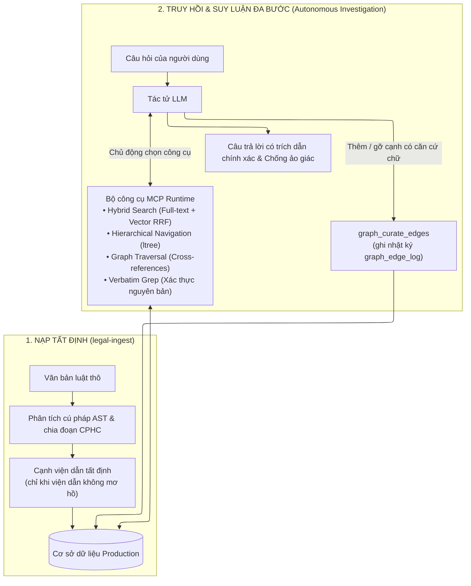

# Vietnamese Traffic Law Agentic RAG Platform

📌 **Task Tracking Board (Notion):** [Theo dõi tiến độ công việc tại đây](https://app.notion.com/p/3dda6736665180e0a325d5ad6290fba5?v=3dda6736665180c39bfd000c1bd53cb0)

---

## Giới thiệu tổng quan

Hệ thống **Vietnamese Traffic Law Agentic RAG Platform** là nền tảng nghiên cứu và thực nghiệm mô hình tác tử tương tác hai chiều dựa trên giao thức **Model Context Protocol (MCP)** trong lĩnh vực Văn bản Quy phạm Pháp luật Giao thông Đường bộ Việt Nam.

Khác với các mô hình RAG truyền thống vốn chỉ truyền ngữ cảnh tĩnh cho mô hình ngôn ngữ sinh câu trả lời, hệ thống mở rộng không gian công cụ (Action Space) cho mô hình ngôn ngữ lớn (LLM) để tự hành tham gia vào toàn bộ vòng đời của tri thức: từ giai đoạn tiền xử lý, cấu trúc hóa dữ liệu có sự giám sát của con người đến giai đoạn truy hồi và suy luận pháp lý đa bước.

---

## Kiến trúc hai chiều của hệ thống



---

## Các thành phần cốt lõi

1. **Khung công cụ chuẩn hóa Model Context Protocol (MCP):**
   * **Nhóm công cụ hiệu chỉnh đồ thị (Graph Curation):** Khi trả lời câu hỏi, tác tử thêm cạnh quan hệ còn thiếu hoặc gỡ cạnh sai; mỗi cạnh phải dựa trên cụm viện dẫn nguyên văn trong đoạn nguồn và mọi thay đổi được ghi nhật ký.
   * **Nhóm công cụ truy hồi (Runtime Sensors):** Cung cấp các giác quan cho tác tử tự hành tìm kiếm kết hợp (Hybrid Search), điều hướng dọc theo cây cấu trúc Chương/Điều/Khoản/Điểm, lần theo đồ thị quan hệ và so khớp văn bản nguyên bản.

2. **Nạp dữ liệu tất định (`uv run rag-eval legal-ingest`):**
   * Văn bản thô được phân tích cây phân cấp (`ltree`), chia đoạn bảo toàn ngữ cảnh cha-con (CPHC); câu chữ mỗi đoạn đúng bằng lát cắt dòng của văn bản gốc.
   * Viện dẫn nội bộ không mơ hồ ("khoản 2 Điều này", "Điều 5 của Nghị định này"), nằm ngoài đoạn trích dẫn, được nối thành cạnh tự động; nạp lại giữ nguyên các cạnh còn căn cứ.

3. **Cơ chế suy luận có căn cứ và Kiểm soát tính chính xác (Zero-Hallucination):**
   * Tác tử tự đánh giá mức độ đầy đủ của bằng chứng thu thập được qua từng bước điều tra.
   * Tự động kích hoạt cơ chế từ chối trả lời khi không có quy định điều chỉnh hoặc thiếu dữ liệu, đảm bảo mọi thông tin đưa ra đều có trích dẫn điều khoản minh bạch và kiểm chứng được.

---

## Chạy nhanh với cơ sở dữ liệu có sẵn (không cần nạp, không cần embed)

Tệp `data/snapshot/rag_legal.jsonl.gz` (~15 MB) chứa toàn bộ dữ liệu: văn bản, các đoạn kèm vector embedding, cạnh đồ thị và nhật ký cạnh. Chỉ cần khởi động PostgreSQL rồi nạp tệp này:

```bash
uv sync
docker compose up -d                 # PostgreSQL 16 + pgvector, cổng 15432
uv run rag-eval legal-import         # chạy migration rồi nạp snapshot trong một transaction
uv run rag-eval ui                   # giao diện tra cứu và hỏi đáp (cần Node.js/npm để dựng frontend)
```

* Cơ sở dữ liệu đích phải còn trống; thêm `--replace` để xóa văn bản, đoạn và cạnh đang có rồi nạp lại.
* `--path <tệp>` chọn tệp snapshot khác (mặc định `data/snapshot/rag_legal.jsonl.gz`).
* Nạp xong, mọi đoạn đã có vector nên không cần `legal-embed`; bảng `embedding_cache` được dựng lại từ chính các vector đó.
* Lệnh từ chối nạp nếu bộ migration hoặc mô hình embedding của snapshot khác với mã nguồn đang chạy: hãy checkout đúng commit tạo ra snapshot.
* Sau khi thay đổi dữ liệu (nạp lại văn bản, thêm/gỡ cạnh), chạy `uv run rag-eval legal-export` để ghi lại snapshot. Mỗi lần ghi lại rồi commit làm lịch sử git nặng thêm khoảng 15 MB.

Muốn dựng cơ sở dữ liệu từ văn bản gốc thay vì dùng snapshot: `uv run rag-eval legal-migrate`, `legal-convert`, rồi `legal-ingest` (xem [AGENTS.md](AGENTS.md)).

---

Chi tiết về đề cương nghiên cứu, phương pháp luận và các tình huống ứng dụng thực tế được trình bày đầy đủ tại [PROPOSAL.md](PROPOSAL.md).
