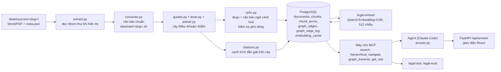
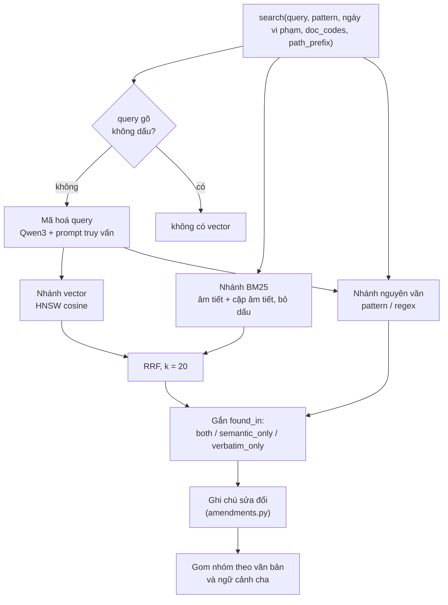

# Thiết kế hệ thống

Chương này mô tả hệ thống đúng như trong mã nguồn của nhánh `task/thesis-integration` (`main` + PR #15, #16, #17), tức bản đã dùng để đo ở chương 2 và chương 3. Mọi đường dẫn file trong chương tính từ gốc repo. Người đọc có thể mở đúng file đó để kiểm tra.

## 1. Tổng quan kiến trúc

Hệ thống có bốn tầng:

1. **Nạp văn bản** (`src/rag_eval/legal/ingestion/`): đọc file Word/PDF gốc, chuyển thành văn bản chuẩn, phân tích thành cây Điều–Khoản–Điểm, cắt thành đoạn, giải liên kết trích dẫn, tính vector.
2. **Lưu trữ** (PostgreSQL với các extension `pgvector`, `ltree`, `unaccent`): văn bản, đoạn, chỉ mục từ khoá, cạnh trích dẫn, bộ đệm vector.
3. **Tra cứu** (`src/rag_eval/legal/mcp/`, `src/rag_eval/legal/retrieval/`): các công cụ chỉ đọc, đưa ra ngoài qua giao thức MCP.
4. **Trả lời và giao diện** (`src/rag_eval/legal/answer.py`, `src/rag_eval/legal/web/`, `frontend/`): agent gọi công cụ để trả lời, API web và giao diện người dùng.

Bên cạnh là **bộ công cụ đánh giá** (`src/rag_eval/legal/eval/`, `scripts/answer_eval.py`, `scripts/agent_eval.py`), dùng đúng đường chạy của sản phẩm.

Một số thuật ngữ dùng trong chương:

- **Đoạn (chunk):** đơn vị lưu trữ và tìm kiếm, ứng với phần chữ riêng của một nút trong cây văn bản (một Điểm, một Khoản, phần mở đầu của một Điều…).
- **Đường dẫn (path):** khoá phân cấp kiểu `ltree` của PostgreSQL, ví dụ `168_2024_nd_cp.c_ii.s_1.a_6.c_9.p_b` là Điểm b Khoản 9 Điều 6 Mục 1 Chương II Nghị định 168/2024. Mọi công cụ nhận và trả về đường dẫn này.
- **Văn bản ngữ cảnh hoá (contextualized text):** chữ của đoạn được ghép thêm tên văn bản, các cấp cha và câu dẫn của Điều/Khoản cha. Đây là chữ được đánh chỉ mục và tính vector.
- **Nguyên văn (verbatim text):** đúng các dòng của văn bản gốc mà đoạn chiếm giữ. Đây là chữ được trích cho người đọc.



*Hình 6.1. Luồng dữ liệu từ văn bản nguồn đến câu trả lời.*

## 2. Nạp văn bản

### 2.1. Nguồn và siêu dữ liệu

Mỗi văn bản là một thư mục trong `data/sources/`, ví dụ `data/sources/168-2024-ND-CP/`. Thư mục chứa file gốc và một file `meta.json`. File này là nguồn duy nhất cho: mã văn bản (`doc_code`), tên văn bản, ngày có hiệu lực, ngày hết hiệu lực hoặc văn bản thay thế, văn bản mà nó sửa đổi (`amends`) hoặc hợp nhất (`consolidates`), và danh sách file cấu thành (`parts`).

Tên văn bản phải mở đầu bằng loại văn bản ("Nghị định …", "Luật … (văn bản hợp nhất)"). Lý do: văn bản tự gọi mình theo loại khi trích dẫn nội bộ ("Nghị định này"), và bộ giải trích dẫn dùng chính thông tin đó (mục 2.4).

Kho hiện tại có 14 văn bản:

- ba luật ở dạng văn bản hợp nhất: Luật Trật tự, an toàn giao thông đường bộ (55/VBHN-VPQH), Luật Đường bộ (144/2026/VBHN-LQ-VPQH), Luật Xử lý vi phạm hành chính (171/2026/VBHN-LQ-VPQH);
- năm nghị định: 151/2024/NĐ-CP (quy định chi tiết Luật Trật tự, an toàn giao thông đường bộ), 168/2024/NĐ-CP (xử phạt, trừ điểm giấy phép lái xe), và ba nghị định sửa đổi 184/2025, 236/2026, 238/2026;
- năm thông tư: 38/2024/TT-BGTVT (tốc độ và khoảng cách an toàn), 65/2024/TT-BCA (kiểm tra kiến thức để phục hồi điểm) cùng hai thông tư sửa đổi nó (13/2025, 105/2026), 108/2026/TT-BCA (sát hạch, cấp giấy phép lái xe);
- QCVN 41:2024/BGTVT về báo hiệu đường bộ.

### 2.2. Chuyển đổi

Lệnh `uv run rag-eval legal-convert` biến mỗi thư mục nguồn thành một file văn bản chuẩn `data/raw/<slug>.txt`. Có hai bước:

- **Trích xuất** (`ingestion/extract.py`). File Word được đọc như Word hiển thị, gồm cả đánh số tự động, bảng và các thay đổi đã chấp nhận. Chữ nào của phần thân không được dùng mà cũng không thuộc cấu trúc bị loại có chủ đích (chữ đã xoá, chữ ẩn) thì lệnh dừng với lỗi `ExtractionGapError`. Chữ gõ bằng phông 8-bit cũ (TCVN3, VNI) cũng gây lỗi thay vì bị đọc sai. Nhánh PDF chỉ ở mức thử nghiệm; không văn bản nào trong kho dùng nó.
- **Làm sạch** (`ingestion/converter.py`). Chuẩn hoá Unicode NFC, bỏ ký tự vô hình, mỗi đoạn văn hoặc dòng bảng nằm trên một dòng, bỏ mục lục.

Số dòng trong file văn bản chuẩn là toạ độ chung của cả hệ thống: đoạn lưu `start_line`, `end_line`, và công cụ `get_raw` đọc theo đúng số dòng đó.

### 2.3. Phân tích cấu trúc

Bộ phân tích gồm ba phần.

**Ngoặc kép** (`ingestion/quotes.py`). Văn bản sửa đổi chép lời văn mới của văn bản bị sửa trong ngoặc kép. Ví dụ, Điều 7 Nghị định 238/2026 có dòng "a) Sửa đổi, bổ sung điểm đ như sau:", tiếp theo là dòng `"đ) Điều khiển xe vận tải hành khách theo hợp đồng …"`. Nếu coi dòng thứ hai là cấu trúc thì "đ)" sẽ thành một Điểm giả của Nghị định 238, xen giữa Điểm a và Điểm b của chính nó. Vì vậy chữ trong ngoặc kép (“…”, ‘…’, «…», "…") không bao giờ là cấu trúc hay trích dẫn nội bộ. Ngoặc mở không có ngoặc đóng bị đóng ở cuối dòng, để một lỗi gõ không nuốt phần còn lại của văn bản.

**Bộ tách từ tố cấu trúc** (`ingestion/lexer.py`, `ingestion/grammar.py`). Đọc từng dòng và nhận dạng các cấp theo quy ước soạn thảo văn bản quy phạm pháp luật: Phần, Chương, Mục, Tiểu mục, Điều, Khoản ("1."), Điểm ("a)"), kể cả các cấp được chèn thêm khi sửa đổi (`12a`, `IIa`, `a1`). Ngoài ra còn nhận dạng phụ lục, khối nơi nhận và chữ ký, biểu mẫu ("Mẫu số 01"), và mục đánh số kiểu đề cương (`A.`, `I.`, `1.1.`) trong phụ lục.

**Bộ dựng cây** (`ingestion/parser.py`). Giữ một ngăn xếp các cấp đang mở. Một tiêu đề đóng mọi cấp không thể chứa nó (một Chương đóng Điều và Mục đang mở) rồi mở cấp của nó. Một số thứ tự chỉ được coi là cấu trúc nếu nó là số kế tiếp của cấp đang mở hoặc là số đầu của một cấp mới. Nhờ vậy, một dòng bắt đầu bằng "3." giữa một đoạn văn không bị tách thành Khoản. Dòng nằm sau danh sách Điểm đã kết thúc bằng dấu chấm được gán cho cấp cha (nút `TAIL`), không gán nhầm vào Điểm cuối.

### 2.4. Cắt đoạn và văn bản ngữ cảnh hoá

`ingestion/cphc.py` biến cây thành danh sách đoạn theo một quy tắc duy nhất:

- Mỗi nút (trừ gốc văn bản và biểu mẫu) thành đoạn bằng **phần chữ riêng** của nó. Nút lá lấy toàn bộ phạm vi dòng. Nút có con lấy phần chữ trước con đầu tiên, với đường dẫn `<nút>.body`.
- **Phủ dòng:** mọi dòng không rỗng nằm trong đúng một đoạn, trừ dòng tiêu đề của các cấp (được đưa vào ngữ cảnh) và dòng biểu mẫu. Hàm `_assert_line_coverage` kiểm tra điều này. Dòng nằm trong 0 hoặc từ 2 đoạn trở lên làm lệnh nạp thất bại với mã `E_INVALID_DOCUMENT_HIERARCHY`, kèm số dòng.
- **Nguyên văn chính xác:** `verbatim_text` của đoạn đúng bằng các dòng từ `start_line` đến `end_line` của văn bản chuẩn.
- **Đoạn quá dài** (vượt 25.000 ký tự, chủ yếu là bảng trong QCVN và phụ lục) được chia thành các cửa sổ `.w_1`, `.w_2`… theo ranh giới dòng. Cửa sổ bắt đầu giữa bảng mang theo tên bảng và dòng tiêu đề cột trong phần ngữ cảnh, không trong phần nguyên văn.

Văn bản ngữ cảnh hoá của một đoạn có dạng:

```
[Tên văn bản] > [Chương II] > [Điều 6: Xử phạt người điều khiển xe ô tô …] > [Khoản 9: Phạt tiền từ 18.000.000 đồng đến 20.000.000 đồng đối với …]
<nguyên văn của Điểm>
```

Hai chi tiết đáng chú ý:

- **Câu dẫn của Khoản cha đi kèm Điểm.** Trong nghị định xử phạt, mức tiền nằm ở câu dẫn của Khoản ("Phạt tiền từ … đến … đồng đối với người điều khiển xe thực hiện một trong các hành vi vi phạm sau đây:"), còn hành vi nằm ở Điểm. Theo đo đạc ghi trong `answer.py` (hàm `_provision_text`), chỉ 2,0% số đoạn tự chứa một số tiền. Không có câu dẫn thì đoạn tìm được không trả lời được câu "phạt bao nhiêu".
- **Tiêu đề Chương được rút gọn thành nhãn** (hàm `_compact_chapter`). Trước đó, 843 đoạn của Nghị định 168 đều mở đầu bằng cùng 361 ký tự tiêu đề Chương II viết hoa, chiếm khoảng 61% độ dài trung bình của chuỗi được tính vector. Phần lặp này làm mờ tên Điều, vốn là thứ duy nhất phân biệt "xe ô tô" với "xe mô tô".

### 2.5. Cạnh trích dẫn

`ingestion/citations.py` tìm các cụm trích dẫn nội bộ trong mỗi đoạn và biến chúng thành cạnh `REFERENCES` trong bảng `graph_edges`. Một cụm chỉ thành cạnh khi thoả đủ ba điều kiện:

1. Nằm ngoài ngoặc kép.
2. Được neo bằng chữ "này": hoặc chỉ một cấp của chính văn bản ("điểm a khoản 9 Điều này", "Mục 1 Chương này"), hoặc chỉ văn bản bao quanh theo đúng loại của nó ("Điều 5 Thông tư này"). Do đó "Luật này" xuất hiện trong một Nghị định không neo vào đâu cả.
3. Mọi cấp được nêu phải giải được về **đúng một** nút trên cây đã phân tích, theo bộ ba (nút cha, loại cấp, nhãn).

Khoảng ("từ khoản 1 đến khoản 3") được mở theo thứ tự anh em thật trên cây, nên Khoản chèn thêm (2a) cũng được tính. Một cạnh trỏ tới Điều hoặc Khoản được tách thành cạnh tới từng đoạn lá bên dưới.

Khi nạp lại, cạnh mất đoạn nguồn, đoạn đích hoặc mất căn cứ chữ bị xoá và ghi nhật ký `INVALIDATED`. Việc nạp một văn bản nằm trong một giao dịch (`ingestion/pipeline.py`).

### 2.6. Vector

- **Mô hình:** `Qwen/Qwen3-Embedding-0.6B`, chạy bằng `sentence-transformers`, cắt vector còn 512 chiều và chuẩn hoá L2 (`ingestion/embedder.py`). Mô hình được huấn luyện theo kiểu Matryoshka nên cắt bớt chiều vẫn dùng được (xem chương 7).
- **Câu hỏi** được mã hoá kèm prompt truy vấn của mô hình (`QUERY_PROMPT_NAME = "query"`). **Đoạn** được mã hoá không kèm prompt.
- **Bộ đệm** `embedding_cache` lưu mọi vector đã tính, khoá theo (mô hình, số chiều, SHA-256 của chuỗi). Khi nạp lại hoặc so sánh mô hình (`scripts/embedding_sweep.py`), chữ không đổi thì dùng lại vector.
- **Tách khỏi giao dịch:** vector còn thiếu được tính bởi lệnh `legal-embed`, ngoài mọi giao dịch, nên lần tính trên GPU không giữ khoá cơ sở dữ liệu.

## 3. Lược đồ cơ sở dữ liệu

Lược đồ được dựng bằng chuỗi migration trong `src/rag_eval/legal/db/sql/` (001 đến 022). Các bảng đang dùng:

| Bảng | Nội dung chính | Chỉ mục |
| :-- | :-- | :-- |
| `documents` | `doc_code` (duy nhất), tên, ngày hiệu lực và hết hiệu lực, `metadata` (gồm `amends`), `raw_text` (văn bản chuẩn đầy đủ) | theo mã, theo ngày |
| `chunks` | `path` (`ltree`, duy nhất), `verbatim_text`, `contextualized_text`, `embedding` (`vector(512)`), `start_line`, `end_line`, ngày hiệu lực, `metadata` (loại nút, nhãn, tên Chương/Mục/Điều), `syllable_count` | HNSW cosine trên `embedding`; GiST và B-tree trên `path`; theo ngày |
| `chunk_terms` | chỉ mục ngược cho BM25: (`term`, `chunk_id`, `tf`, `syllable_count`) | khoá chính (`term`, `chunk_id`) |
| `graph_edges` | cạnh giữa hai đoạn: nguồn, đích, loại quan hệ, `citation_text` bắt buộc | theo nguồn, theo đích |
| `graph_edge_log` | nhật ký thêm, gỡ, vô hiệu cạnh, với người thực hiện (`INGEST` hoặc `AGENT`) và lý do; khoá theo đường dẫn vì đoạn có thể biến mất khi nạp lại | GiST trên `source_path` |
| `relation_types` | danh mục loại quan hệ (`REFERENCES`, `MODIFIES_AND_REPLACES`, `GUIDES`…) | |
| `embedding_cache` | vector đã tính, khoá (mô hình, số chiều, SHA-256 chuỗi) | khoá chính |

Bảng `chunk_terms` được trigger tính lại mỗi khi `contextualized_text` thay đổi (`022_bm25_keyword_branch.sql`). Toàn bộ cơ sở dữ liệu xuất và nhập được dưới dạng snapshot (`data/snapshot/rag_legal.jsonl.gz`); các phép đo ở chương 2 dùng cơ sở dữ liệu nạp mới từ snapshot này.

## 4. Tra cứu

### 4.1. Công cụ `search`

`search` là công cụ chính. Nó nhận hai đầu vào bắt buộc:

- `query`: câu tìm theo nghĩa, thường đã được agent viết lại bằng thuật ngữ luật;
- `pattern`: cụm từ phải có nguyên văn trong điều khoản cần tìm, hoặc một biểu thức chính quy nếu `is_regex` bật;

và các bộ lọc tuỳ chọn: `temporal_violation_date` (ngày xảy ra vi phạm), `doc_codes` (giới hạn văn bản), `path_prefix` (giới hạn một nhánh cây), `limit`.

Bên trong có ba nhánh (`mcp/tools/sensors.py`, hàm `search`; SQL ở `db/sql/022_bm25_keyword_branch.sql`).

**Nhánh vector.** Câu `query` được mã hoá bằng Qwen3-Embedding với prompt truy vấn. Cơ sở dữ liệu lấy các đoạn gần nhất theo khoảng cách cosine (chỉ mục HNSW). Số ứng viên của mỗi nhánh là `max(6 × limit, 120)`. Nếu `query` gõ không dấu (hàm `is_unaccented` trong `text.py`), nhánh này bị tắt: kho được mã hoá từ chữ có dấu, nên câu không dấu rơi rất xa đáp án trong không gian vector.

**Nhánh BM25.** Hàm SQL `legal_syllables` bỏ dấu (`unaccent`), chuyển chữ thường và tách văn bản thành các âm tiết chữ-số. Hàm `legal_terms` sinh hai loại từ: âm tiết đơn và cặp hai âm tiết liền nhau (ví dụ `den_tin`, `tin_hieu`). Điểm của mỗi đoạn tính theo công thức BM25 chuẩn với k1 = 1,2 và b = 0,75:

  IDF(t) = ln(1 + (N − n_t + 0,5) / (n_t + 0,5))

  điểm(d) = Σ_t IDF(t) · tf(t, d) · (k1 + 1) / (tf(t, d) + k1 · (1 − b + b · |d| / avgdl))

với N là số đoạn, n_t là số đoạn chứa từ t, |d| là số âm tiết của đoạn, avgdl là độ dài trung bình. Vì cả kho và câu hỏi đều bỏ dấu trước khi tách, câu gõ không dấu khớp được với văn bản có dấu. Cặp âm tiết thay cho bước tách từ tiếng Việt: "đèn tín hiệu" sinh các cặp `den_tin` và `tin_hieu`, đủ để phân biệt với "tín hiệu" đứng riêng mà không cần từ điển.

**Gộp hai nhánh bằng RRF.** Thứ hạng của hai nhánh được gộp bằng Reciprocal Rank Fusion: điểm(d) = 1/(k + hạng_vector(d)) + 1/(k + hạng_BM25(d)), với k = 20 (hằng số `RRF_K` trong `sensors.py`). Đoạn chỉ có ở một nhánh chỉ nhận một số hạng.

**Nhánh nguyên văn.** Hàm SQL `verbatim_grep` lấy mọi đoạn có `contextualized_text` chứa `pattern` (so khớp chuỗi con không phân biệt hoa thường, hoặc biểu thức chính quy). Một cụm phổ biến có thể khớp hàng nghìn đoạn; ví dụ "phục hồi điểm" có trong tên Nghị định 168 nên khớp mọi đoạn của nghị định này. Vì vậy kết quả được **xếp theo khoảng cách tới vector câu hỏi**, rồi mới cắt `limit`. Kết quả trả về kèm tổng số đoạn khớp và cờ báo bị cắt bớt.

**Lọc theo hiệu lực và phạm vi.** Cả ba nhánh chỉ giữ đoạn có `effective_date ≤ ngày vi phạm` và chưa hết hiệu lực vào ngày đó. Ngày vi phạm mặc định là hôm nay theo giờ Việt Nam. `doc_codes` và `path_prefix` thu hẹp phạm vi ngay trong truy vấn SQL, trước khi xếp hạng.

**Gắn nhãn và gom nhóm kết quả.** Mỗi điều khoản trả về mang nhãn `found_in`:

- `both`: có ở kết quả gộp và chứa `pattern`, đáng tin nhất;
- `semantic_only`: chỉ có ở kết quả gộp;
- `verbatim_only`: chỉ có ở nhánh nguyên văn.

Các điều khoản cùng văn bản và cùng ngữ cảnh cha được gom thành một nhóm (`group_ranked` trong `schemas/retrieval.py`). Ngữ cảnh (Chương > Điều > Khoản, gồm cả câu dẫn mức phạt) chỉ ghi một lần cho cả nhóm, nhờ vậy kết quả gửi cho agent ngắn hơn. Danh sách `documents` cho tên và hiệu lực của từng văn bản xuất hiện.



*Hình 6.2. Các nhánh của công cụ `search`. Cả ba nhánh đều lọc theo ngày vi phạm và phạm vi văn bản trong SQL.*

Trong mã còn một bộ xếp hạng lại bằng cross-encoder (`retrieval/reranker.py`, mô hình `cross-encoder/mmarco-mMiniLMv2-L12-H384-v1`). Bộ này **tắt theo mặc định** (`rerank_by_default=False` trong `web/app.py`) và không được dùng trong các phép đo của chương 2.

### 4.2. Ghi chú văn bản sửa đổi

Nghị định 168/2024 đã bị sửa bởi các nghị định ra sau. Nếu chỉ trả lại nguyên văn Điều 6 của Nghị định 168, người dùng có thể nhận một mức phạt đã thay đổi. `retrieval/amendments.py` gắn cho mỗi kết quả trường `amended_by`, liệt kê các câu lệnh đang sửa nó.

Cách làm:

1. Đọc toàn bộ đoạn của các văn bản, theo thứ tự dòng. Che chữ trong ngoặc kép (hàm `_masked`) để lời văn được chép lại không bị đọc như câu lệnh.
2. Tìm các dòng mở đầu bằng động từ sửa đổi: "sửa đổi", "bổ sung", "bãi bỏ", "thay thế", "hủy bỏ", "bỏ" (biểu thức `_INSTRUCTION`). Mỗi dòng như vậy là một câu lệnh ở cấp Khoản hoặc Điểm của văn bản sửa đổi.
3. Xác định đích của câu lệnh bằng chính bộ phân tích trích dẫn của mục 2.5 (`cited_divisions`). Phần cấp còn thiếu được kế thừa từ câu lệnh bao ngoài. Ví dụ trong Nghị định 238/2026: tiêu đề "Điều 7. Sửa đổi, bổ sung một số điểm, khoản của Điều 20", Khoản 1 "Sửa đổi, bổ sung một số điểm của khoản 5 như sau:", Điểm a "Sửa đổi, bổ sung điểm đ như sau:". Điểm a chỉ nêu "điểm đ"; nó lấy "khoản 5" từ Khoản 1 và "Điều 20" từ tiêu đề Điều, nên đích là Điểm đ Khoản 5 Điều 20 Nghị định 168/2024. Chỉ câu lệnh trong cùng (Điểm a) thành ghi chú; câu lệnh bao ngoài chỉ cung cấp phạm vi. Văn bản đích lấy từ số hiệu văn bản nêu trong câu lệnh, nếu không có thì từ trường `amends` của `meta.json`.
4. Lập chỉ mục từ (văn bản đích, Điều) đến các câu lệnh. Khi trả kết quả, chỉ gắn những câu lệnh **có hiệu lực vào ngày vi phạm** và có đích phủ đúng đoạn đó.

Mỗi ghi chú gồm văn bản sửa, nhãn câu lệnh, hành động, đích, ngày có hiệu lực và đường dẫn của câu lệnh, để agent mở nó bằng `hierarchical_navigate`. Bản trước (PR #14) đọc tiêu đề Điều sửa đổi và gắn sai khoảng 395 trên 686 đoạn (chương 4, mục 4); bản hiện tại (PR #16) đọc từng câu lệnh.

### 4.3. Các công cụ còn lại

| Công cụ | Mục đích | Agent trả lời có được gọi |
| :-- | :-- | :-- |
| `search` | Tìm điều khoản theo nghĩa và theo cụm từ nguyên văn (mục 4.1) | Có |
| `hierarchical_navigate` | Đọc toàn bộ một nhánh cây: cả Điều, cả Khoản, hoặc nút cha (`scope = parent_context`), theo thứ tự đọc, tối đa 100 đoạn | Có |
| `graph_traverse` | Đi theo cạnh trích dẫn từ một điều khoản, theo chiều ra hoặc vào, tối đa một độ sâu cho trước, lọc theo loại quan hệ | Có |
| `get_raw` | Đọc nguyên văn các dòng của văn bản chuẩn (tối đa 100 dòng mỗi lần), dùng khi một đoạn có vẻ bị cắt lệch | Có |
| `graph_curate_edges` | Thêm hoặc gỡ cạnh trích dẫn, mỗi cạnh mới phải có `citation_text` nằm nguyên văn trong đoạn nguồn; ghi nhật ký kèm lý do | Không (chỉ dùng khi bảo trì đồ thị) |

Bốn công cụ đầu chỉ đọc. Mọi kết quả đều mang `doc_code`, `path`, `start_line`, `end_line`, nên agent đi tiếp từ kết quả này sang công cụ khác mà không phải đoán tham số. Công cụ được khai báo trong `mcp/registry.py`, mô tả tham số bằng tiếng Việt. Máy chủ MCP (`mcp/server.py`) gửi kèm một chỉ dẫn gồm quy trình tra cứu và danh mục văn bản sinh từ cơ sở dữ liệu, để agent biết mã văn bản truyền vào `doc_codes`.

## 5. Trả lời

### 5.1. Chế độ agent

Đây là chế độ mặc định của giao diện và là chế độ được đo ở chương 3. Mã nằm ở `answer.py`, hàm `answer_with_agent`.

1. **Khởi chạy.** Hệ thống chạy Claude Code ở chế độ không tương tác (`claude -p`) trong một thư mục tạm rỗng, kèm cấu hình MCP chỉ có máy chủ luật (`--strict-mcp-config`). Danh sách công cụ cho phép (`--allowedTools`) chỉ gồm bốn công cụ chỉ đọc: `search`, `hierarchical_navigate`, `graph_traverse`, `get_raw`. Tối đa 10 lượt và 300 giây. Thư mục rỗng để agent không đọc mã nguồn của repo thay vì tra luật. Máy chủ MCP không kết nối được thì lần chạy là lỗi, không phải câu trả lời.
2. **Prompt** (`_AGENT_PROMPT`) yêu cầu agent:
   - chỉ dùng công cụ, không dùng kiến thức riêng;
   - viết `query` bằng thuật ngữ văn bản luật ("vượt đèn đỏ" thành "không chấp hành hiệu lệnh của đèn tín hiệu giao thông") và đặt `pattern` là cụm chắc chắn có nguyên văn;
   - với câu hỏi mức phạt, chọn điều khoản chế tài và đọc mức tiền ở Khoản cha;
   - tìm lại hoặc mở cả Điều khi kết quả lệch chủ đề; đi theo trích dẫn bằng `graph_traverse`;
   - mở câu lệnh sửa đổi khi có `amended_by` và đưa cả hai điều vào nguồn;
   - trả lời tối đa ba câu, đặt `[#n]` sau mỗi khẳng định, và kết thúc bằng một dòng JSON gồm `answer` và `sources` (số thứ tự và đường dẫn).
3. **Đánh số lại trích dẫn.** Hệ thống đọc lại các đường dẫn trong `sources` từ cơ sở dữ liệu, gắn ghi chú sửa đổi, rồi thay mỗi `[#n]` bằng vị trí thật của nguồn trong danh sách trả về (`_renumber_citations`). Trích dẫn trỏ tới nguồn không tồn tại bị xoá khỏi câu trả lời. Người dùng chỉ thấy điều khoản đọc từ cơ sở dữ liệu, không thấy chữ do agent tự chép.
4. **Kiểm tra bám nguồn** (`check_grounding`). Mọi "Điều N" trong câu trả lời phải là số Điều của một nguồn được trích. Mọi số tiền ("… đồng", "… triệu đồng") phải có trong chữ của các nguồn được trích. Phép kiểm tra này hẹp có chủ đích: nó không đánh giá câu trả lời có hiểu đúng luật không, chỉ kiểm câu trả lời có ra ngoài văn bản được trích không.
5. **Trả lời lại một lần.** Nếu kiểm tra thất bại, agent được chạy lại với phản hồi nêu rõ các số liệu không có trong nguồn và câu trả lời bị loại. Hệ thống giữ lần có ít khẳng định không bám nguồn hơn. Thời gian và chi phí của hai lần được cộng lại.

Chương 5 đã chỉ ra một hạn chế của bước 4: số Điều có ngay trong chữ của nguồn (ví dụ danh sách điều bị bãi bỏ) vẫn bị coi là không bám nguồn. Mã còn hỗ trợ một CLI agent thứ hai (`agy`), nhưng các phép đo chỉ dùng Claude Code.

### 5.2. Chế độ tìm một lần

Khi tắt "Tra cứu kỹ hơn" trên giao diện, `/api/answer` chạy chế độ `retrieve`:

1. gọi `hybrid_search` (vector + BM25, không có nhánh nguyên văn) với câu hỏi người dùng gõ;
2. ghép lại các cửa sổ của cùng một điều khoản dài (`expand_windows`), ưu tiên cửa sổ được tìm thấy và các cửa sổ liền kề;
3. gửi tối đa năm điều khoản (dạng ngữ cảnh hoá) cùng câu hỏi cho một mô hình qua CLI (`compose`), với prompt yêu cầu chỉ dùng điều khoản được cung cấp và trích `[#n]`;
4. chạy cùng phép kiểm tra bám nguồn, nhưng không trả lời lại.

Nếu không có kết quả nào chứa từ khoá của câu hỏi (độ tin cậy `none`, tính trong `SearchResult.confidence`), hệ thống không gọi mô hình mà trả lời là không tìm thấy căn cứ. Chế độ này nhanh (khoảng nửa giây cho tìm kiếm) nhưng kém hơn nhiều với câu khẩu ngữ (chương 3).

### 5.3. API web và giao diện

API viết bằng FastAPI (`web/app.py`, `web/router.py`). Khi khởi động, mô hình embedding được nạp sẵn để câu hỏi đầu tiên không phải chờ. Các điểm cuối chính:

| Điểm cuối | Chức năng |
| :-- | :-- |
| `POST /api/search` | Tìm điều khoản. Với `deep = true`, một agent chọn tối đa năm điều khoản (`locate_with_agent`) thay vì trả kết quả tìm kiếm thô |
| `POST /api/answer` | Trả lời câu hỏi, `mode = agent` hoặc `retrieve` |
| `GET /api/answer/providers` | Các CLI agent có trên máy |
| `GET /api/documents` | Danh mục văn bản và số đoạn |
| `/api/eval/...` | Xem, sửa, chạy từng câu hoặc cả bộ đánh giá tìm kiếm |

Giao diện viết bằng React và Tailwind (`frontend/`). Thanh đầu trang có ba thẻ (`components/layout/AppHeader.tsx`):

- **Hỏi đáp:** ô hỏi, lựa chọn "Tra cứu kỹ hơn" (chế độ agent), câu trả lời có trích dẫn `[#n]`, và danh sách nguồn kèm ghi chú sửa đổi (`AmendmentNotice.tsx`);
- **Tra cứu điều luật:** tìm điều khoản theo ngày vi phạm và phạm vi văn bản, có lựa chọn để agent chọn điều khoản;
- **Đánh giá tìm kiếm:** công cụ cho người phát triển, xem và chạy bộ `retrieval.jsonl`.

Hai thẻ đầu dành cho người dùng cuối. Giao diện có tiếng Việt và tiếng Anh (`i18n/messages.ts`), và ba chế độ màu: sáng, tối, theo hệ thống (`hooks/useTheme.ts`).

## 6. Công cụ đánh giá

| Công cụ | Dữ liệu | Đo gì | Lệnh |
| :-- | :-- | :-- | :-- |
| `legal-eval` (`eval/retrieval.py`) | `data/eval/retrieval.jsonl`: 715 câu, 592 dev, 123 holdout | Với lời gọi `search` đầu tiên agent viết cho câu hỏi, điều khoản đáp án rơi vào nhóm nào: `both`, `semantic_only`, `verbatim_only` hay `missed` | `uv run rag-eval legal-eval [--split dev\|holdout]` |
| `scripts/answer_eval.py` (`eval/answers.py`) | `data/eval/answers.jsonl`: 81 câu, 71 trong phạm vi, 10 ngoài phạm vi | Câu trả lời cuối của `answer_with_agent`: trích đúng Điều, đúng Khoản/Điểm, đủ mức tiền và dữ kiện, bám nguồn, từ chối đúng | `uv run python scripts/answer_eval.py --budget <USD>`; `--only <id>` chạy một phần, `--report` in kết quả |
| `scripts/agent_eval.py` | mẫu câu từ `retrieval.jsonl` | Điều khoản agent trích, ghép cặp với kết quả của lời gọi `search` đã ghi, trên cùng câu hỏi | `uv run python scripts/agent_eval.py --n 40 --split holdout` |

Ba điểm thiết kế chung:

- **Đo đúng đường chạy thật.** `answer_eval.py` gọi đúng hàm `answer_with_agent` mà giao diện dùng. `legal-eval` gọi đúng `search` của máy chủ MCP.
- **Lỗi hạ tầng không thành điểm.** Lỗi hết hạn mức tài khoản, lỗi nhà cung cấp, hoặc máy chủ MCP không kết nối được ghi nhận là lỗi và được chạy lại khi tiếp tục. Chúng không bị chấm là "từ chối đúng" hay "trả lời sai" (chương 4, mục 5).
- **Có thể tiếp tục.** Kết quả ghi nối vào `experiments/runs/*.jsonl`, nên lần chạy bị ngắt chạy tiếp từ câu chưa xong.

## 7. Các quyết định thiết kế

Mỗi quyết định dưới đây được nêu cùng lý do, cái giá phải trả, và nơi người đọc có thể kiểm tra.

**7.1. Phân tích theo quy ước soạn thảo thay vì cắt đoạn cố định.**

- *Lý do:*
  - Người dùng cần trích đến Điều, Khoản, Điểm. Đoạn cắt theo độ dài không biết mình thuộc Điểm nào.
  - Mức phạt nằm ở Khoản cha, hành vi ở Điểm con. Cắt cố định có thể tách hai phần này; cắt theo cây ghép được câu dẫn vào từng Điểm.
  - Quy ước soạn thảo dùng chung cho mọi văn bản, nên không cần quy tắc riêng cho từng văn bản. Đây là yêu cầu "nạp văn bản mới không phải sửa mã" trong `AGENTS.md`.
  - Kiểm tra phủ dòng biến lỗi phân tích thành lỗi nạp có số dòng, thay vì mất nội dung trong im lặng.
- *Cái giá:* bộ phân tích phải xử lý nhiều trường hợp (ngoặc kép, cấp chèn thêm, phụ lục, bảng). Biểu mẫu không được tách đoạn.
- *Kiểm tra tại:* `ingestion/parser.py`, `ingestion/cphc.py`.

**7.2. BM25 trên âm tiết không dấu thay cho `ts_rank`.**

- *Lý do:*
  - `ts_rank` không có IDF và không chuẩn hoá độ dài. Chỉ riêng nhánh từ khoá, Hit@1 trên tập dev tăng từ 13,7% lên 57,8% khi thay bằng BM25 (chương 2).
  - Bỏ dấu giúp câu không dấu khớp được kho có dấu.
  - Cặp âm tiết thay cho bước tách từ, không cần từ điển ngoài.
  - k1 = 1,2 và b = 0,75 là giá trị thông dụng, không chỉnh theo bộ đề.
- *Cái giá:* thêm bảng `chunk_terms` và khoảng 50 ms mỗi lần tìm (trung vị).
- *Kiểm tra tại:* `db/sql/022_bm25_keyword_branch.sql`.

**7.3. Tìm lai, gộp bằng RRF với k = 20.**

- *Lý do:*
  - Hai nhánh trượt ở những câu khác nhau: nhánh vector bắt cách diễn đạt khác chữ trong luật, nhánh BM25 bắt thuật ngữ chính xác và câu không dấu.
  - RRF chỉ dùng thứ hạng, nên không cần chuẩn hoá hai thang điểm.
  - Với k = 60, kết quả hạng 1–3 của một nhánh có thể rơi khỏi top 10 sau khi gộp (chương 5).
- *Cái giá:* k = 20 được chọn bằng cách nhìn tập dev (chương 4).
- *Kiểm tra tại:* `mcp/tools/sensors.py` (`RRF_K`).

**7.4. Nhánh nguyên văn, xếp theo vector câu hỏi.**

- *Lý do:*
  - Agent thường biết một cụm chắc chắn có trong điều khoản cần tìm. Nhánh này cứu những câu mà cả hai nhánh xếp hạng đẩy đáp án xuống thấp.
  - Xếp theo thứ tự văn bản thì kết quả đầu luôn là các đoạn đầu của văn bản đầu tiên.
- *Cái giá:* khoảng 90 ms truy vấn thêm. Không cải thiện Hit@1 (chương 2).
- *Kiểm tra tại:* hàm `verbatim_grep` trong `022_bm25_keyword_branch.sql`.

**7.5. Agent nhiều bước thay vì RAG một lần.**

- *Lý do:*
  - Câu hỏi thật là khẩu ngữ, không dấu, viết tắt. Câu hỏi chỉ đi vào agent; agent viết lại thành lời gọi `search` bằng thuật ngữ luật, nên cách gõ của người dùng không đi thẳng vào bộ tìm kiếm.
  - Nhiều câu cần đọc cả Điều, đi theo trích dẫn hoặc mở văn bản sửa đổi.
- *Cái giá:* khoảng 37 giây và 0,16 USD mỗi câu, và phụ thuộc một mô hình thương mại. Chế độ tìm một lần được giữ cho trường hợp cần nhanh.
- *Kiểm tra tại:* `answer.py` (`answer_with_agent`, `compose`).

**7.6. MCP làm giao diện giữa agent và kho luật.**

- *Lý do:*
  - Một máy chủ phục vụ agent trả lời, các script đánh giá, lệnh `legal-tool`, và về nguyên tắc mọi ứng dụng hỗ trợ MCP. `answer.py` đã cấu hình hai CLI agent (Claude Code và `agy`) trên cùng bộ công cụ.
  - Quyền được khai báo rõ: agent trả lời chỉ được bốn công cụ chỉ đọc. Công cụ ghi `graph_curate_edges` nằm ngoài danh sách.
  - Mô tả công cụ và danh mục văn bản đi kèm giao thức.
- *Cái giá:* mỗi câu trả lời phải khởi động một tiến trình agent và một tiến trình máy chủ MCP. Lỗi kết nối phải được phát hiện riêng.
- *Kiểm tra tại:* `mcp/server.py`, `mcp/registry.py`, `AGENT_TOOLS` trong `answer.py`.

**7.7. Kiểm tra bám nguồn bằng quy tắc, không bằng mô hình.**

- *Lý do:*
  - Hai lỗi nguy hiểm nhất là trích một Điều không được tìm thấy và nêu một mức phạt không có trong văn bản. Cả hai kiểm được chắc chắn bằng so khớp.
  - Một mô hình chấm có thể sai theo cách khó phát hiện, và tốn thêm chi phí.
- *Cái giá:* không đánh giá được việc hiểu đúng luật. Còn có một lỗi đã biết với số Điều nằm trong chữ của nguồn (chương 5).
- *Kiểm tra tại:* `check_grounding` trong `answer.py`.

**7.8. Suy ra quan hệ sửa đổi từ câu lệnh, không nhập tay.**

- *Lý do:*
  - Nhập tay vi phạm yêu cầu tổng quát hoá: văn bản sửa đổi mới sẽ cần người nhập.
  - Câu lệnh sửa đổi có cú pháp ổn định, đọc được bằng cùng ngữ pháp trích dẫn.
- *Cái giá:* chưa xử lý đích không đánh số, các cấp trên Điều, và câu lệnh sửa đổi bị bãi bỏ về sau (chương 4).
- *Kiểm tra tại:* `retrieval/amendments.py`.

**7.9. Mô hình embedding nhỏ, cắt 512 chiều.**

- *Lý do:* đa ngôn ngữ, nhận chuỗi dài, chạy được trên GPU 4 GB.
- *Cái giá:* khoảng 9 câu trượt trên tập dev được quy cho mô hình embedding (chương 5). Bản 4B chưa đo được trên kho hiện tại (chương 2).
- *Kiểm tra tại:* `ingestion/embedder.py`, `scripts/embedding_sweep.py`.

## 8. Tóm tắt

Hệ thống gồm bốn tầng:

1. nạp văn bản tất định, có kiểm tra phủ dòng;
2. một cơ sở dữ liệu chứa vector, chỉ mục từ khoá, đồ thị trích dẫn và văn bản gốc;
3. bộ công cụ tra cứu chỉ đọc đưa ra qua MCP;
4. agent dùng các công cụ đó để trả lời, có kiểm tra bám nguồn.

Các phép đo ở chương 2 và 3 chạy trên đúng các thành phần này.
